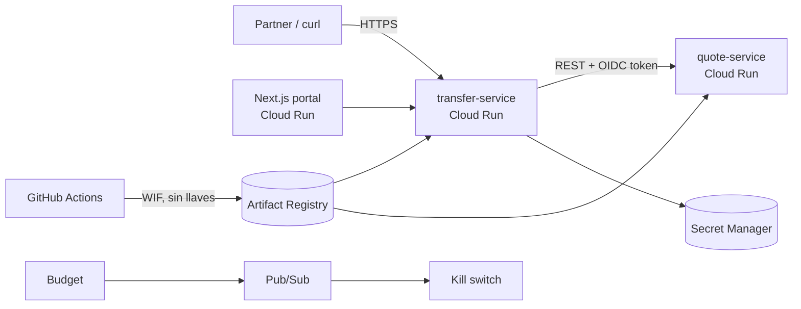

# Fase 0 — Fundamentos aplicados sobre GCP (16 semanas · 8 h/semana)

> Ruta Infra · Manuel Cardoza · Inicio: semana del 19-oct-2026
>
> Regla de esta fase: **cada concepto termina en código dentro del monorepo `puente`**. Cero teoría suelta.


## 1. El proyecto: **Puente** — plataforma de remesas y pagos transfronterizos con APIs abiertas

### Por qué este dominio
- Las remesas son una parte enorme de la economía salvadoreña. Tu historia en una entrevista se cuenta sola: "construí la plataforma que mueve el dinero que sostiene a mi país".
- Es **distinto** a lo que haces en el trabajo (no es transferencia interbancaria doméstica): es **cross-border, multi-moneda, con compliance**.
- Obliga a resolver los problemas difíciles de verdad: **dinero que no se puede duplicar ni perder**, auditoría, latencia, partners externos poco confiables y regulación.

### Qué hace (negocio)
Fintechs y casas de remesas ("partners") se integran por API para:

1. **Cotizar** un envío USA → SV/GT/HN (tipo de cambio, fee, cotización válida 60 s).
2. **Crear la transferencia** con `Idempotency-Key` (reintentos del partner nunca duplican dinero).
3. **Screening de compliance**: listas de sanciones (lista pública OFAC SDN), límites por cliente, reglas de velocity anti-fraude.
4. **Ledger de doble partida**: cada movimiento es un asiento débito/crédito inmutable y cuadrado.
5. **Payout** a banco o billetera mediante adapters simulados que **fallan a propósito** (timeouts, respuestas duplicadas, 500 intermitentes).
6. **Webhooks firmados (HMAC)** al partner con reintentos exponenciales y DLQ.
7. **Portal Next.js** para partners (API keys, transferencias, estado, webhooks) y **backoffice** para revisar casos marcados por compliance.

### Microservicios (Spring Boot 3.x · Java 21)
| Servicio | Responsabilidad | Patrón clave que aprendes |
|---|---|---|
| `quote-service` | Cotizaciones FX con TTL | Caché, expiración, consistencia |
| `transfer-service` | Orquesta el ciclo de vida | **Saga orquestada**, máquina de estados |
| `compliance-service` | Sanciones, límites, velocity | Reglas, auditoría, colas de revisión manual |
| `ledger-service` | Doble partida inmutable | **Consistencia fuerte**, transacciones, outbox |
| `payout-service` | Adapters a bancos/billeteras falsos | **Idempotencia**, circuit breaker, reintentos |
| `webhook-service` | Notificaciones firmadas | At-least-once, **DLQ**, backoff |
| `partner-portal` (Next.js + TS) | Portal + backoffice | Auth real (OIDC), CDN |

**Apigee al frente**: API products por partner, OAuth2 client-credentials, quotas por plan, spike arrest, verificación de firma, versionado `/v1`, `/v2`. Usas el **Apigee Emulator** local (gratis) y una **org de evaluación** solo en un sprint corto de la Fase 1 (es temporal; confirma la duración al crearla).

### Requisitos no funcionales (objetivo final v4)
- Disponibilidad `POST /transfers`: **99.9 %** · p95 < 300 ms (sin contar payout asíncrono).
- **RPO 0 para el ledger** (nunca perder un asiento) · RTO < 1 h.
- Cero transferencias duplicadas bajo reintentos (se demuestra con una prueba de carga + chaos).
- Toda acción auditada; PII cifrada; ningún secreto en código; CI sin llaves (WIF).
- Costo de aprendizaje: **≤ $0/mes en reposo** (todo se destruye o queda en free tier).

> En la Fase 0 **no construyes todo esto**. Construyes el "walking skeleton": `quote-service` + `transfer-service` + frontend mínimo en Cloud Run, con IaC, CI/CD sin llaves y guardrails de costo. El resto llega en las fases siguientes.


## 2. Créditos de GCP: cómo no quemarlos

- Los **$300 de créditos duran ~90 días desde la activación**: planifica los labs de pago dentro de esa ventana.
- Usa un **proyecto dedicado** solo para Puente (`puente-dev-xxxx`). Labels obligatorias: `app=puente`, `env=dev`, `owner=manuel`, `lab=<id>`.
- Gasta créditos solo en lo que no puedes hacer local: **redes (VPC, Cloud NAT, LBs, Cloud DNS, Cloud Armor), Cloud SQL efímero**.
- Todo lo demás es local o free tier: Linux, Docker, TLS, K8s (kind/k3d), Postgres/Redis en contenedor, Apigee Emulator.

**Servicios caros (aprox., confirma en la calculadora):**
| Recurso | Costo aprox. | Alternativa para aprender |
|---|---|---|
| External HTTP(S) LB | ~$18+/mes por forwarding rule | Crear → probar → destruir en la misma sesión |
| Memorystore Redis | ~$35+/mes (1 GB básico) | Redis en contenedor local; idempotencia en Postgres |
| Cloud SQL | ~$10+/mes la instancia más pequeña | Postgres local; Cloud SQL solo en labs de 2–3 h |
| Cloud Armor | ~$5/mes por policy + reglas | Solo en el lab de WAF |
| GKE | $0.10/h por cluster; free tier de **$74.40/mes** por billing account (Autopilot o zonal) | Un solo cluster zonal/Autopilot → cubierto por el free tier (Fase 2) |
| Apigee pago | Cientos a miles $/mes | Emulator + eval org temporal |

**Los budgets alertan, no frenan el gasto.** El lab A3 construye un *kill switch* real.


## 3. Método de estudio (lee esto antes que cualquier comando)

### 3.1 Tu semana de 8 h
| Día | Tiempo | Qué |
|---|---|---|
| Martes | 1.5 h | Concepto nuevo: doc oficial **en inglés** + predicción escrita + mini-ejercicio |
| Jueves | 1.5 h | Lab corto (parte 1) o "rompe y arregla" |
| Sábado | 4 h | **Lab largo / proyecto** (bloque continuo: aquí van los `apply`/`destroy`) |
| Domingo | 1 h | Repaso semanal: blank-page recall, flashcards, journal, plan de la semana |

Las flashcards en el bus o en filas **no cuentan** dentro de las 8 h. Son bonus.

### 3.2 El ciclo de cada tema (no lo saltes)
1. **Predice**: antes de leer, escribe en 2 líneas cómo crees que funciona. Equivocarte primero hace que lo correcto se fije.
2. **Haz**: el lab, escribiendo tú los comandos (no copiar y pegar a ciegas la primera vez).
3. **Rompe**: cambia una cosa para que falle y diagnostica *sin mirar la solución*. Aquí se aprende infra de verdad.
4. **Explica**: escribe 5–10 líneas **en inglés** como si fuera un README o un mensaje a un junior (técnica Feynman). Practicas inglés y te sirve para el portafolio.
5. **Repasa**: crea 3–5 flashcards de lo que te costó.

### 3.3 ¿Cuaderno? Sí, pero con reglas
Siendo honesto: la evidencia de que "escribir a mano siempre es mejor" es **mixta**. Lo que sí está sólido es la **práctica de recuperación** (sacar la información de tu cabeza) y la **repetición espaciada**. Úsalos así:

- **Cuaderno físico (cuadriculado)** → solo para **dibujar**: diagramas de red, flujo de un request DNS → TLS → LB → Cloud Run, la saga de una transferencia. Regla del domingo: **página en blanco**, dibuja de memoria lo de la semana y después compara. Lo que no pudiste dibujar es lo que no sabes.
- **Notas digitales (Markdown en repo privado `infra-notebook`, u Obsidian)** → comandos, runbooks y troubleshooting. Tienen que ser **buscables**; a mano no lo son.
- **Anki** → tarjetas de *por qué* y de *diagnóstico*, no de sintaxis. Ejemplo: "Cloud Run responde 503 tras el deploy, el log dice `container failed to listen on PORT` → ¿causa?".
- **Prohibido**: transcribir la documentación. Si lo copias, no lo procesas.

### 3.4 La IA como tutor, no como muleta
- ✅ "Hazme 5 preguntas sobre NAT y corrígeme." · "Genera este Terraform y yo encuentro los errores." · "Explícame este error."
- ❌ "Resuélveme el lab."
- Regla de los **20 minutos**: atascado 20 min sin avanzar → pregunta. Antes de eso, pelea; después, es tiempo perdido.

### 3.5 Medición honesta
Cada bloque cierra con un checklist **"lo hago sin mirar"**. Si no lo haces sin mirar, no está aprendido. Repite el lab, no lo marques.


## 4. Mapa actualizado (GCP primero)

| Fase | Semanas | Contenido | Certificación |
|---|---|---|---|
| **0. Fundamentos sobre GCP** | 1–16 | Esta fase · walking skeleton de Puente | — |
| 1. Puente v1–v2 | 17–36 | Cloud Run → red privada, Cloud SQL, Pub/Sub, Apigee, Identity Platform | **ACE** ($125, disponible en español) |
| 2. Kubernetes + Puente v3 | 37–56 | kind local → GKE (free tier), Argo CD, Gateway API | **CKA** |
| 3. Puente v4 | 57–72 | Multi-región, DR probado, SLOs, FinOps, Cloud Armor | **PCA** · Terraform Associate |
| **Hito ~mes 18** | | Portafolio sólido · aplicar a roles Cloud/Platform | |
| 4. AWS | 73–104 | Segundo proyecto | SAA → DevOps Pro |
| 5. Azure + Multicloud | 105+ | Tercer proyecto + integración | AZ-104 / AZ-305 |


## 5. Estructura del monorepo

**ADR-0001: monorepo.** *Decisión:* un solo repo `puente`. *Por qué:* un desarrollador, cambios atómicos app+infra+Apigee, un solo pipeline con path filters, más fácil de mostrar en el portafolio. *Descartado:* multi-repo (overhead de versionado entre repos, sin beneficio para una persona). *Cuándo cambiarlo:* varios equipos con ciclos de release independientes o permisos distintos por componente.

```
puente/
├── README.md                     # Pitch, diagrama, cómo correrlo, decisiones
├── Makefile                      # make up / test / plan / destroy
├── .editorconfig  .gitignore  .pre-commit-config.yaml  CODEOWNERS
├── docs/
│   ├── adr/                      # 0001-monorepo.md, 0002-…
│   ├── architecture/             # Diagramas Mermaid por versión v0…v4
│   ├── runbooks/                 # Un runbook por alerta
│   ├── postmortems/              # Simulacros y fallas reales
│   └── labs/                     # Bitácora de cada lab (qué hice, qué rompí)
├── services/                     # Maven multi-module
│   ├── pom.xml                   # parent: versiones, plugins (Jib, JaCoCo)
│   ├── quote-service/
│   ├── transfer-service/
│   ├── compliance-service/       # (Fase 1)
│   ├── ledger-service/           # (Fase 1)
│   ├── payout-service/           # (Fase 1)
│   └── webhook-service/          # (Fase 1)
├── frontend/partner-portal/      # Next.js
├── apigee/
│   ├── proxies/                  # (Fase 1)
│   └── sharedflows/
├── infra/
│   ├── terraform/
│   │   ├── bootstrap/            # State bucket, WIF, CI service account (se aplica 1 vez, local)
│   │   ├── modules/              # cloud-run-service, network, budget…
│   │   └── envs/dev/             # Raíz que compone módulos
│   └── native/                   # Infrastructure Manager (comparación, Fase 1)
├── platform/k8s/                 # (Fase 2) Helm/Kustomize, Argo CD
├── labs/                         # Código desechable de mini-labs de fundamentos
├── tests/
│   ├── load/                     # k6
│   └── contract/
└── .github/workflows/
    ├── app-ci.yml
    ├── infra-plan.yml
    └── infra-apply.yml
```


## 6. Bloques de la Fase 0

### Bloque A · Semanas 1–2 · Setup y guardrails (primero el freno, después el motor)

**Objetivo:** que nada se pueda crear sin budget, labels, estado remoto ni CI sin llaves.

#### A1 · Herramientas en el M1 (sábado, 1 h)
```bash
# Runtime de contenedores (elige UNO): OrbStack (ligero en M1) o Colima
brew install orbstack            # o: brew install colima docker docker-buildx

brew install git gh jq yq pre-commit tflint trivy syft cosign k6 multipass
brew tap hashicorp/tap && brew install hashicorp/tap/terraform
brew install --cask google-cloud-sdk   # si brew avisa que se renombró, usa el nombre que indique

# Java 21 con SDKMAN
curl -s "https://get.sdkman.io" | bash
sdk install java 21-tem
```

#### A2 · Proyecto + budget ANTES de cualquier recurso (sábado, 1.5 h · $0)
```bash
export BILLING_ACCOUNT=$(gcloud billing accounts list --format="value(name)" --limit=1)
export PROJECT_ID="puente-dev-$RANDOM"
export REGION="us-central1"     # free tier, precios bajos, buena latencia desde SV

gcloud projects create "$PROJECT_ID" --labels=app=puente,env=dev,owner=manuel
gcloud billing projects link "$PROJECT_ID" --billing-account="$BILLING_ACCOUNT"
gcloud config set project "$PROJECT_ID"

gcloud services enable billingbudgets.googleapis.com cloudresourcemanager.googleapis.com \
  iam.googleapis.com iamcredentials.googleapis.com sts.googleapis.com \
  run.googleapis.com artifactregistry.googleapis.com secretmanager.googleapis.com

# Budget sobre COSTO BRUTO (excluye créditos) para ver cuánto crédito quemas
gcloud billing budgets create \
  --billing-account="$BILLING_ACCOUNT" \
  --display-name="puente-dev-budget" \
  --filter-projects="projects/$PROJECT_ID" \
  --budget-amount=100USD \
  --credit-types-treatment=exclude-all-credits \
  --threshold-rule=percent=0.25 \
  --threshold-rule=percent=0.50 \
  --threshold-rule=percent=0.90 \
  --threshold-rule=percent=1.00
```
**Por qué $100/mes bruto:** ~$300 en 3 meses = tus créditos. Al 25 % ya sabes si un lab se quedó encendido.

#### A3 · Lab "kill switch" (2 h · ~$0)
Budget → Pub/Sub → Cloud Run function que **desvincula el billing** del proyecto al llegar al 100 %. Prueba con un budget de $1 en un proyecto de prueba.
*Trade-off:* desvincular billing **apaga todo** (puede borrar recursos). Aceptable en un lab, **jamás en producción**. Escribe el ADR-0002.

#### A4 · Terraform bootstrap: estado remoto + WIF para GitHub (sábado, 3 h · $0)
`infra/terraform/bootstrap/main.tf`
```hcl
terraform {
  required_version = ">= 1.9"
  required_providers {
    google = { source = "hashicorp/google", version = "~> 6.0" }
  }
}

variable "project_id"  { type = string }
variable "region" {
  type    = string
  default = "us-central1"
}
variable "github_repo" { type = string } # "tu-usuario/puente"

provider "google" {
  project = var.project_id
  region  = var.region
  default_labels = { app = "puente", env = "dev", owner = "manuel", managed_by = "terraform" }
}

resource "google_storage_bucket" "tfstate" {
  name                        = "${var.project_id}-tfstate"
  location                    = var.region
  uniform_bucket_level_access = true
  public_access_prevention    = "enforced"
  versioning { enabled = true }          # recuperas el state si se corrompe
  lifecycle_rule {
    condition { num_newer_versions = 10 }
    action    { type = "Delete" }
  }
}

resource "google_iam_workload_identity_pool" "github" {
  workload_identity_pool_id = "github"
  display_name              = "GitHub Actions"
}

resource "google_iam_workload_identity_pool_provider" "github" {
  workload_identity_pool_id          = google_iam_workload_identity_pool.github.workload_identity_pool_id
  workload_identity_pool_provider_id = "github-oidc"
  attribute_mapping = {
    "google.subject"       = "assertion.sub"
    "attribute.repository" = "assertion.repository"
    "attribute.ref"        = "assertion.ref"
  }
  # Sin esta condición, CUALQUIER repo de GitHub podría pedir tokens a tu pool
  attribute_condition = "assertion.repository == \"${var.github_repo}\""
  oidc { issuer_uri = "https://token.actions.githubusercontent.com" }
}

resource "google_service_account" "ci" {
  account_id   = "github-ci"
  display_name = "GitHub Actions CI"
}

resource "google_service_account_iam_member" "ci_wif" {
  service_account_id = google_service_account.ci.name
  role               = "roles/iam.workloadIdentityUser"
  member             = "principalSet://iam.googleapis.com/${google_iam_workload_identity_pool.github.name}/attribute.repository/${var.github_repo}"
}

output "wif_provider"     { value = google_iam_workload_identity_pool_provider.github.name }
output "ci_service_email" { value = google_service_account.ci.email }
```
```bash
cd infra/terraform/bootstrap
terraform init
terraform apply -var="project_id=$PROJECT_ID" -var="github_repo=TU_USUARIO/puente"
```
**Por qué el bootstrap usa state local:** es el huevo y la gallina; el bucket aún no existe. Haz commit del código pero **nunca** del `terraform.tfstate` (va en `.gitignore`). Después migras su state al bucket con `terraform init -migrate-state` (ejercicio extra).

**Rompe y arregla:** cambia `attribute_condition` a otro repo y corre el workflow → ¿qué error da? Documenta en `docs/labs/A4.md`.

#### Checklist A (sin mirar)
- [ ] Explico por qué un budget no detiene el gasto y cómo sí detenerlo.
- [ ] Explico qué es OIDC/WIF y por qué es mejor que una JSON key.
- [ ] Explico qué guarda el state de Terraform y qué pasa si dos personas hacen `apply` a la vez (locking).

---

### Bloque B · Semanas 3–5 · Linux y Bash para operación ($0, local)

Laboratorio: VM Ubuntu ARM con `multipass launch --name ops --memory 2G`.

**Temas:** procesos y señales (SIGTERM vs SIGKILL → *graceful shutdown* de Spring Boot), systemd (units, journald), permisos/usuarios/umask, filesystem (inodes, mounts, `df` vs `du`), red desde el SO (`ss`, `ip`, `dig`, `curl -v`, `tcpdump`), recursos (`top`, `free`, `vmstat`, OOM killer), Bash robusto (`set -euo pipefail`, `trap`, funciones).

| Lab | Tiempo | Qué haces | Rompe y arregla |
|---|---|---|---|
| B1 · Spring Boot como servicio systemd | 2 h | Unit con usuario sin privilegios, restart policy, logs en journald | El servicio muere en bucle → diagnostica con `journalctl -u` |
| B2 · Graceful shutdown | 2 h | `server.shutdown=graceful`; manda SIGTERM durante una carga con k6 | Compara SIGKILL: ¿cuántos requests se pierden? |
| B3 · "El disco está lleno" | 1.5 h | Llena el disco con logs | `df` dice lleno pero `du` no encuentra nada → archivo borrado aún abierto (`lsof +L1`) |
| B4 · OOM killer | 1.5 h | JVM con `-Xmx` mayor que la RAM disponible | Lee `dmesg`, entiende por qué el contenedor/proceso muere sin stacktrace |
| B5 · Script de destroy seguro | 2 h | `scripts/nuke-lab.sh`: borra recursos por label `lab=<id>` con confirmación y `--dry-run` | Corre sin labels y comprueba que no borra nada fuera del lab |

#### Checklist B
- [ ] Diagnostico por qué un proceso no arranca usando solo `systemctl` y `journalctl`.
- [ ] Explico qué hace Spring Boot al recibir SIGTERM y por qué importa en Cloud Run/K8s.
- [ ] Escribo un script Bash que falla de forma segura (`set -euo pipefail` + `trap`).

---

### Bloque C · Semanas 6–9 · Redes (el núcleo de la fase · aquí sí gastas créditos)

**Temas:** OSI/TCP-IP en la práctica, TCP handshake, subnetting/CIDR (a mano, sin calculadora), routing y tablas de rutas, NAT, **DNS a fondo** (recursión, TTL, zonas privadas, split-horizon), HTTP/1.1 vs 2 vs 3, **TLS y mTLS** (cadena de confianza, SNI, certificados), balanceo L4 vs L7, reverse proxies, CDN.

**Tabla de equivalencias (la usas en toda la ruta):**
| Concepto | GCP | AWS | Azure |
|---|---|---|---|
| Red | VPC **global**, subnets **regionales** | VPC regional, subnets por AZ | VNet regional, subnets |
| Salida a internet sin IP pública | Cloud NAT (gestionado, sin VM) | NAT Gateway por AZ | NAT Gateway |
| Firewall | Firewall rules / policies (por VPC, con tags/SA) | Security Groups + NACLs | NSG |
| DNS privado | Cloud DNS private zones | Route 53 private hosted zones | Private DNS zones |
| LB L7 global | External Application LB | CloudFront + ALB | Front Door |
| Acceso privado a servicios gestionados | Private Service Connect / Private Google Access | PrivateLink / VPC endpoints | Private Endpoints |

| Lab | Tiempo | Costo aprox. | Qué haces | Rompe y arregla |
|---|---|---|---|---|
| C1 · Subnetting a mano | 1.5 h | $0 | Diseña el plan IP de Puente: dev/stg/prod × 2 regiones + rangos para GKE (pods/services) sin solapamientos. Guárdalo como ADR | Detecta el solapamiento que dejé a propósito en tu plan y explica qué rompería (peering, VPN) |
| C2 · VPC custom con Terraform | 3 h | <$1 | VPC sin auto-mode, 2 subnets, firewall deny-all + allow por tag, VM **sin IP pública** con acceso por IAP | La VM no llega a internet → agrega **Cloud NAT** y explica por qué antes no salía |
| C3 · DNS privado | 2 h | <$0.50 | Zona privada `puente.internal`, registros A/CNAME, `dig +trace` público vs privado | Cambia un registro con TTL alto y mide cuánto tarda en "propagarse" (caché) |
| C4 · TLS y mTLS local | 3 h | $0 | Crea tu propia CA con `openssl`, emite certificados server/client, nginx con mTLS, `curl --cert` | Certificado expirado, CN/SAN incorrecto, cadena incompleta: reproduce y lee cada error |
| C5 · L4 vs L7 | 3 h | ~$1 (destruir el mismo día) | External Application LB frente a Cloud Run (serverless NEG) con certificado gestionado | Health check o path mal configurado → 502/404; diagnostica con los logs del LB |
| C6 · Cloud Armor básico | 2 h | ~$1 | Rate limiting y bloqueo por país/IP delante del LB de C5 | Te bloqueas a ti mismo → lee los logs de Armor para entender por qué |

**Regla de oro:** cada lab de pago se crea y destruye **en la misma sesión**: `terraform apply` al inicio, `terraform destroy` antes de cerrar la laptop. Verifica con `gcloud compute forwarding-rules list`.

#### Checklist C
- [ ] Calculo a mano cuántas IPs útiles tiene un /22 en GCP (GCP reserva 4 por subnet).
- [ ] Dibujo de memoria el camino completo de `https://api.puente.dev/quotes`: DNS → TLS → LB → Cloud Run.
- [ ] Explico por qué una VM sin IP pública no sale a internet y dos formas de resolverlo.
- [ ] Leo un error TLS y digo si es de cadena, de nombre o de fecha.
- [ ] Explico cuándo usar un LB L4 y cuándo L7.

---

### Bloque D · Semanas 10–12 · Contenedores a fondo

**Temas:** capas y caché de imágenes, multi-stage, distroless, **Jib vs Buildpacks vs Dockerfile**, multi-arch con `buildx` (tu M1 es arm64 y Cloud Run usa amd64), usuario no-root, escaneo (Trivy), SBOM (Syft), firma (cosign), Artifact Registry.

| Lab | Tiempo | Qué haces | Rompe y arregla |
|---|---|---|---|
| D1 · Tres formas de construir `quote-service` | 3 h | Dockerfile multi-stage → distroless; Jib; Buildpacks. Compara tamaño, tiempo de build y CVEs (Trivy). Elige uno y escribe el ADR | Imagen construida en el M1 (arm64) desplegada en Cloud Run → `exec format error`. Arréglalo con `--platform linux/amd64` o buildx |
| D2 · JVM en contenedor | 2 h | `-XX:MaxRAMPercentage`, límites de memoria, arranque en frío en Cloud Run | Límite de 256 Mi → OOM; mide la memoria real y ajusta |
| D3 · Supply chain | 2 h | SBOM con Syft, firma con cosign (keyless OIDC en CI), push a Artifact Registry | Modifica la imagen después de firmarla → la verificación falla |
| D4 · Cloud Run en serio | 3 h | `quote-service` con Terraform: service account propia de mínimo privilegio, secreto en Secret Manager, concurrency, min/max instances, revisiones y tráfico 90/10 | Despliega una revisión rota con tráfico al 10 % y haz rollback sin downtime |

#### Checklist D
- [ ] Explico por qué distroless reduce la superficie de ataque y qué pierdes (shell para debug).
- [ ] Construyo una imagen multi-arch y verifico las arquitecturas con `docker buildx imagetools inspect`.
- [ ] Explico cómo calcula la JVM su heap dentro de un contenedor.
- [ ] Hago un canary y un rollback en Cloud Run.

---

### Bloque E · Semanas 13–14 · Git avanzado y CI/CD sin llaves

**Temas:** trunk-based development, ramas cortas, rebase interactivo vs merge, `bisect`, conventional commits, versionado semántico, release automatizado, branch protection, path filters en monorepo.

| Lab | Tiempo | Qué haces |
|---|---|---|
| E1 · `git bisect` | 1 h | Encuentra el commit que rompió un test entre 30 commits |
| E2 · Pipeline de app | 3 h | `app-ci.yml`: path filter por servicio → tests → Trivy → build/push con WIF → cosign → deploy a Cloud Run |
| E3 · Pipeline de infra | 3 h | `infra-plan.yml` publica el `terraform plan` como comentario en el PR, con tflint/Checkov; `infra-apply.yml` corre solo en `main` con aprobación manual (environment protegido) |
| E4 · Releases | 1 h | release-please o semantic-release: changelog y tags `quote-service-v1.2.0` |

Auth en GitHub Actions (sin llaves):
```yaml
permissions:
  contents: read
  id-token: write   # necesario para pedir el token OIDC
steps:
  - uses: actions/checkout@v4
  - uses: google-github-actions/auth@v2
    with:
      workload_identity_provider: ${{ vars.WIF_PROVIDER }}
      service_account: ${{ vars.CI_SERVICE_ACCOUNT }}
```

#### Checklist E
- [ ] Explico trunk-based vs GitFlow y por qué trunk-based encaja con despliegue continuo.
- [ ] Mi CI no tiene ni una sola llave guardada en GitHub Secrets.
- [ ] Un PR de infra muestra el plan antes del merge, y el apply requiere aprobación.

---

### Bloque F · Semanas 15–16 · Integración: **Puente v0 "walking skeleton"**

**Entregable:** `quote-service` + `transfer-service` (en memoria por ahora, **con `Idempotency-Key` ya funcionando**) + frontend mínimo en Cloud Run. Todo con Terraform, CI/CD con WIF, imágenes firmadas, budget y kill switch.



**Definition of Done (infra):**

- [ ] `make up` levanta todo desde cero; `make destroy` deja $0 en reposo.
- [ ] Llamada servicio-a-servicio autenticada (`quote-service` **no** es público; solo acepta el token de la SA de `transfer-service`).
- [ ] La misma `Idempotency-Key` enviada 50 veces en paralelo (k6) crea **una** transferencia.
- [ ] README con diagrama, 4+ ADRs y cómo correrlo.
- [ ] `docs/labs/` con la bitácora de los "rompe y arregla".


## 7. Cierre de fase

### Preguntas tipo entrevista senior
1. Diseña el plan de direccionamiento IP para una empresa con 3 entornos y 2 regiones que en el futuro se conectará on-prem por VPN. ¿Qué errores evitas?
2. Un servicio en Cloud Run devuelve 502 intermitentes después de un deploy. Guíame por tu diagnóstico, capa por capa.
3. ¿Por qué WIF/OIDC es más seguro que una service account key? ¿Qué pasa si olvidas el `attribute_condition`?
4. ¿Cómo garantizas que un `POST /transfers` reintentado no mueva el dinero dos veces? ¿Dónde guardas la clave y cuánto tiempo?
5. Tu `terraform apply` falló a la mitad. ¿En qué estado queda la infra y el state? ¿Cómo procedes?
6. Distroless vs Alpine vs imagen completa para una app Java en producción: trade-offs.
7. Explica qué pasa entre que escribes una URL HTTPS y recibes la respuesta, hasta el handshake TLS.

### Preguntas tipo examen (estilo ACE)
1. Una VM sin IP externa necesita descargar paquetes de internet. ¿Qué es lo más simple y seguro? → **Cloud NAT** (no asignar IP pública, no montar un proxy en VM).
2. GitHub Actions debe desplegar en Cloud Run sin llaves de larga duración. → **Workload Identity Federation** con un provider OIDC restringido al repo.
3. Quieres probar una nueva revisión de Cloud Run con el 5 % del tráfico. → **Traffic splitting** entre revisiones.
4. Un subnet /24 en GCP, ¿cuántas IPs utilizables? → **252** (GCP reserva 4).
5. Recibir alertas cuando el gasto llegue al 50 % del presupuesto. → **Cloud Billing budget** con threshold rule (no detiene el gasto).

### Retrospectiva (llénala en `docs/labs/retro-fase-0.md`)
- ¿Qué labs repetí y por qué?
- ¿Qué tema me costó más (probablemente redes o TLS)? ¿Qué hago distinto en la Fase 1?
- ¿Cumplí las 8 h? Si no, ¿qué bloque recorto en lugar de "estudiar más"?
- ¿Cuántos créditos quedan y cuándo vencen?
